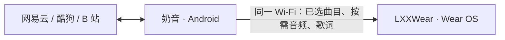

<p align="center">
  
</p>

<h1 align="center">奶音 · Milky Music</h1>

<p align="center"><strong>找到一首歌，校准它的歌词，再把它带到手表上。</strong></p>

<p align="center">
  <a href="https://github.com/zhzipu/milky-music"></a>
  <a href="./LICENSE"></a>
  <a href="https://reactnative.dev/"></a>
</p>

奶音（Milky Music）是一款开源 Android 音乐播放器。它把多音源播放、三引擎听歌识曲、逐首歌词校准、桌面控制和 Wear OS 手表同步串成一套体验；界面适配手机、横屏、平板和折叠屏。

## 奶音的不同之处

| 体验 | 奶音怎么做 |
| --- | --- |
| 听到一首歌，想知道它叫什么 | Shazam、网易云 AFP 和酷狗三引擎并行识别，结果合并后即时显示 |
| 歌词总是早半拍或晚半拍 | 拖动歌词直接对齐；也可单独匹配歌词、调整偏移与歌词倍速 |
| 想在手表上继续听手机歌单 | 选择歌单、曲目和音质；手表在同一 Wi-Fi 下按需向手机取歌，不经云端音乐服务器 |
| 不打开 App 也想看歌词、切歌 | 桌面歌词和主屏幕小组件显示当前播放信息，并提供播放控制 |
| 在平板或折叠屏上播放 | 横屏和大屏采用专门布局，播放控件与导航使用玻璃质感视觉 |

## 音源与识曲

网易云、酷狗和 B 站音频都可在 App 内搜索与播放。B 站作为独立音源，提供分区排行榜、评论、UP 主作品与合集、收藏及视频详情跳转。

听歌识曲由三个引擎并行处理。Shazam 指纹和网易云 AFP 指纹在设备本地计算；查询结果仍需联网。酷狗识曲会将录到的音频发送给酷狗服务。整套识曲不需要自建服务器。



## 歌词与手表

自动匹配不准时，可按歌名和歌手为单首歌曲重新匹配。歌词支持拖动对齐、整体时间偏移和歌词倍速；这些调整只改变歌词时间轴，不改变音乐速度。

配套手表应用 [LXXWear](https://github.com/zhzipu/LXXWear) 与手机连接同一 Wi-Fi 后即可配对。手机提供本地同步服务，手表只请求已选曲目，并按需接收音频和歌词，不依赖云端中转。手机上的歌词校准也会沿用到手表。

## 桌面与大屏

- **主屏幕小组件**：显示封面、歌曲信息、当前歌词、进度及播放控制；提供常规、透明、随应用外观、固定深色和固定浅色样式。
- **桌面歌词**：歌词随播放时间推进，并支持悬浮显示。
- **播放器界面**：深色外观、半透明玻璃质感导航与控件，以及随音乐变化的音频波形。
- **大屏适配**：横屏、平板与折叠屏使用专门布局，不只是拉伸手机界面。

## 构建

目前仓库提供源码，未附带预编译 APK。需要 Node.js 18 或更高版本、JDK 17 和 Android SDK。

```bash
npm ci
npm run bundle-android
cd android
./gradlew assembleDebug
```

Windows PowerShell 中将最后一行替换为：

```powershell
.\gradlew.bat assembleDebug
```

Debug APK 输出到 `android/app/build/outputs/apk/debug/`。正式包名为 `OMG.Milky.Music`，Debug 包名为 `OMG.Milky.Music.dev`。发布构建需自行配置签名材料；不要把密钥或 `keystore.properties` 提交到仓库。

## 项目来源与许可

本项目基于 [lx-music-mobile](https://github.com/lyswhut/lx-music-mobile) 继续开发，感谢上游作者的开源贡献。完整更新记录见 [CHANGELOG.md](./CHANGELOG.md)，常见问题见 [FAQ.md](./FAQ.md)。

音乐内容由第三方服务提供，其内容与可用性受对应服务条款和所在地法律法规约束。项目主体采用 [Apache License 2.0](./LICENSE)。`android/app/src/main/assets/afp/` 中的 AFP 指纹实现来自 [ncm-afp](https://github.com/mos9527/ncm-afp)，采用 MIT License。
